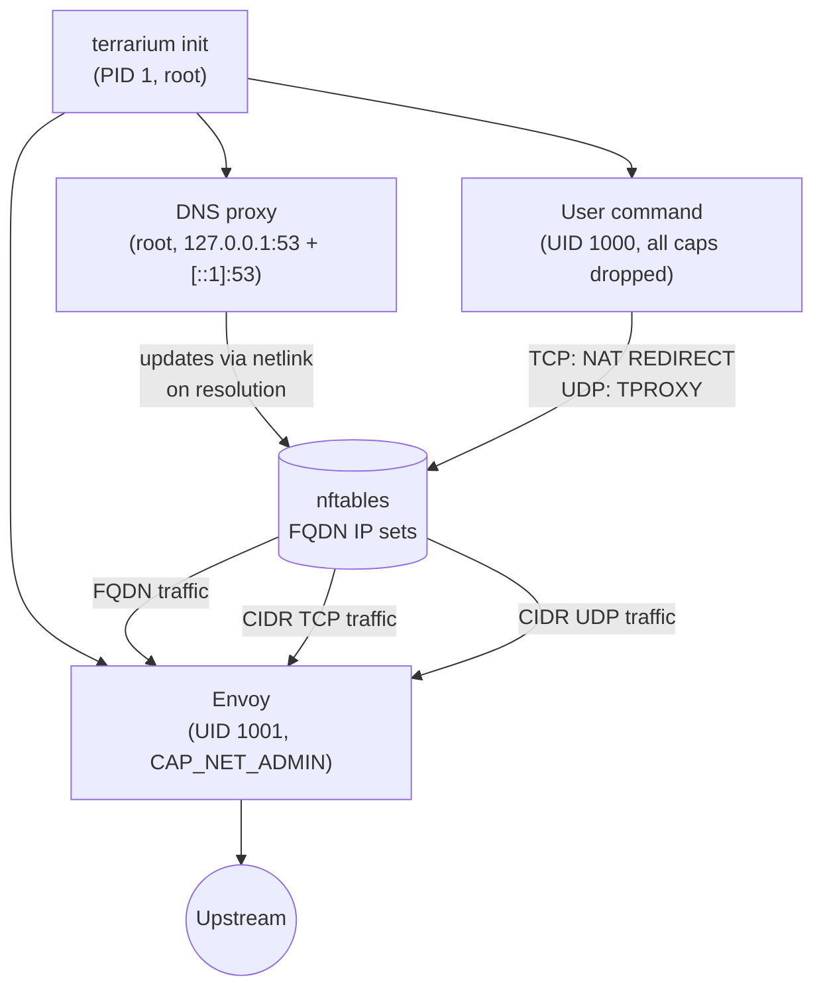
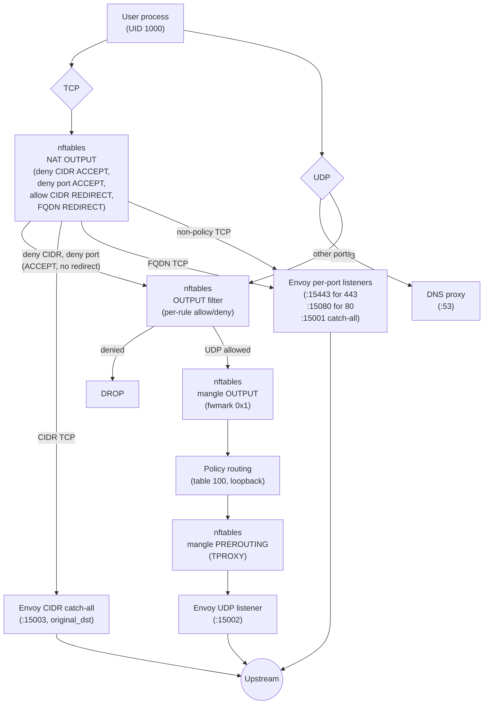

<p align="center">
  <h1 align="center">Terrarium</h1>
</p>

<p align="center">
  <a href="https://pkg.go.dev/go.jacobcolvin.com/terrarium"></a>
  <a href="https://goreportcard.com/report/go.jacobcolvin.com/terrarium"></a>
  <a href="https://codecov.io/gh/macropower/terrarium"></a>
  <a href="#installation"></a>
  <a href="https://github.com/macropower/terrarium/blob/main/LICENSE"></a>
</p>

Terrarium is a secure container environment that uses [Envoy](https://www.envoyproxy.io/) as an L7 egress gateway,
configured via familiar [Cilium](https://cilium.io/) network policy semantics.

> See [CiliumNetworkPolicy Compatibility](docs/cnp-compatibility.md).

Terrarium allows you to declare policies that balance security and functionality,
based on your risk tolerance, environment, and use cases.

It is particularly useful for running fully autonomous AI agents.

## Usage

Published images include the terrarium binary and Envoy but not
language runtimes, package managers, or other tools your workload
needs. Use the image as a base layer or copy the binary into your own
image.

### Use as a base image

The `:debian` variant ships with ca-certificates and Envoy
pre-installed:

```dockerfile
FROM ghcr.io/macropower/terrarium:debian
RUN apt-get update && apt-get install -y python3 && rm -rf /var/lib/apt/lists/*
COPY config.yaml /home/dev/.config/terrarium/config.yaml
ENTRYPOINT ["terrarium", "init", "--"]
CMD ["python3", "app.py"]
```

### Copy the binary into your own image

The `:latest` (scratch) variant contains only the terrarium binary,
which makes it useful as a copy source in a multi-stage build:

```dockerfile
FROM ghcr.io/macropower/terrarium:latest AS terrarium

FROM ubuntu:24.04
RUN apt-get update && apt-get install -y --no-install-recommends \
      ca-certificates envoy && \
    rm -rf /var/lib/apt/lists/*
COPY --from=terrarium /usr/local/bin/terrarium /usr/local/bin/terrarium
COPY config.yaml /home/dev/.config/terrarium/config.yaml
ENTRYPOINT ["terrarium", "init", "--"]
CMD ["/bin/bash"]
```

### Running

However you build your image, `terrarium init` is the main entry point.
It sets up the firewall, DNS proxy, and Envoy, then drops privileges and
execs your command:

```sh
docker run --cap-add=NET_ADMIN my-terrarium-image
```

`--cap-add=NET_ADMIN` is required for nftables. The default config path is
`~/.config/terrarium/config.yaml` (following XDG conventions); override it with
`--config`. Use `--ready-file` to create a file once all infrastructure is up,
useful for orchestration. See `terrarium init --help` for the full flag
reference.

### Use as a Claude Code proxy

`terrarium proxy` runs the same egress policy as a plain HTTP forward proxy on
the host instead of a transparent gateway inside a container. It needs no root,
no nftables, and no network namespaces -- it binds a loopback socket and
supervises an Envoy subprocess. Point `sandbox.network.httpProxyPort` at it
to replace the [Claude Code sandbox proxy](https://code.claude.com/docs/en/sandboxing)
for HTTP traffic. Your existing network policies then filter every sandboxed
HTTP request.

The proxy runs an Envoy build that terrarium pins by version and by
SHA-256, so you do not install Envoy yourself. When the binary is
missing, the proxy installs the build into
`$XDG_DATA_HOME/terrarium/envoy`, which defaults to
`~/.local/share/terrarium/envoy`. The binary is missing at the first
start of the proxy and at the first start after a terrarium upgrade that
changes the pinned version. To install the build ahead of time, for
example on a machine that starts the proxy offline, run the following
command:

```sh
terrarium envoy install
```

The command prints the path of the installed binary. The proxy checks
the hash of that binary at every start. When the binary does not have
the pinned hash, the proxy exits with an error, and it does not download
a replacement. A binary that changed after the install therefore stops
the next start of the proxy, and the changed Envoy does not run. Inspect
the file that the error names, remove it, and run
`terrarium envoy install`.

The [`envoy` workflow](.github/workflows/envoy.yaml) checks each pinned
build on every pull request that changes the pinned version or the code
that generates the Envoy configuration of the proxy. For every build, the
workflow confirms that the download and the binary have the pinned
hashes. It then runs the binary and confirms that the binary reports the
commit of the Envoy release tag. The workflow also confirms that the
binary accepts Envoy configurations of the proxy. Together, those
configurations name every Envoy extension type and every format command
that the proxy configures.

Terrarium pins one build for each platform in the following table. The
table names the source of each build and the check that applies only to
that source.

| Platform                              | Source                                                                     | Check of the source                                                                                                      |
| ------------------------------------- | -------------------------------------------------------------------------- | ------------------------------------------------------------------------------------------------------------------------ |
| Linux with glibc, `amd64` and `arm64` | [Envoy GitHub releases](https://github.com/envoyproxy/envoy/releases)      | The `checksums.txt.asc` file of the release lists the pinned hash and carries a signature of the Envoy maintainers' key. |
| macOS on Apple Silicon                | [Tetrate's archive of Envoy](https://github.com/tetratelabs/archive-envoy) | The index of the archive lists the pinned hash, and the binary has a build attestation from Tetrate's GitHub workflow.   |

The macOS build comes from Tetrate because the Envoy project does not
publish macOS binaries.

On Linux, the proxy executes the open file that it checked. The process
name of that Envoy is a number, and its command line starts with the
path of the binary.

To run another Envoy binary, name it with the `--envoy-path` flag or
with the `envoy.path` key of the policy file. The flag overrides the
key. The value is a path, or a command name that the proxy looks up on
`PATH`. For example, `--envoy-path envoy` runs the Envoy that Homebrew
or Nix installed. The proxy does not check the hash of that binary, and
it logs a warning at every start.

You must name your own binary on the following hosts, because the
managed build does not run on them:

- **An Intel Mac.** Terrarium does not pin a build for it, so the proxy
  exits with an error that names the flag and the key.
- **Musl Linux, such as Alpine Linux.** The Linux builds link against
  glibc, so the proxy exits with the same error.
- **A Linux host without the standard glibc loader, such as NixOS
  without nix-ld.** The proxy installs the managed build, but the build
  does not start. NixOS 24.05 and later puts a stub at the path of the
  loader by default. The stub prints that NixOS cannot run the binary,
  and Envoy exits with status 127. On a host that holds no file at the
  path of the loader, the error names that path. In both cases, the
  error names the flag and the key.
- **A Linux host that does not mount `/proc`.** The proxy executes the
  checked file through `/proc`, so Envoy does not start. The proxy exits
  with an error that names `/proc`, the flag, and the key.

Run the proxy, and write the CA files where the sandbox can read them. The example
writes them to a `proxy` directory beside the CA directory under
`$XDG_DATA_HOME/terrarium`, so one `denyRead` entry covers the key alone:

```sh
terrarium proxy \
  --config ./policy.yaml \
  --http-port 8080 \
  --ca-out ~/.local/share/terrarium/proxy/ca.pem \
  --ca-bundle-out ~/.local/share/terrarium/proxy/bundle.pem
```

The two output files serve different clients:

| Flag              | Contents                                                      | Use with                                                                     |
| ----------------- | ------------------------------------------------------------- | ---------------------------------------------------------------------------- |
| `--ca-out`        | The MITM CA alone, written only when the policy has L7 rules  | `NODE_EXTRA_CA_CERTS`, the macOS keychain                                    |
| `--ca-bundle-out` | The system CA bundle, followed by the MITM CA when one exists | `SSL_CERT_FILE`, `NIX_SSL_CERT_FILE`, `REQUESTS_CA_BUNDLE`, `CURL_CA_BUNDLE` |

A client that reads a single trust file needs the system roots as well as
the MITM CA. The proxy tunnels hosts without L7 rules, so the client
verifies the real server certificate for those hosts.

Then in `~/.claude/settings.json`, with `/Users/me` replaced by your home
directory:

```json
{
  "sandbox": {
    "enabled": true,
    "network": {
      "httpProxyPort": 8080,
      "strictAllowlist": true
    },
    "filesystem": {
      "allowRead": ["~/.local/share/terrarium/proxy"],
      "denyRead": ["~/.local/share/terrarium/ca"],
      "denyWrite": ["~/.local/share/terrarium/envoy"]
    }
  },
  "env": {
    "NODE_EXTRA_CA_CERTS": "/Users/me/.local/share/terrarium/proxy/ca.pem",
    "SSL_CERT_FILE": "/Users/me/.local/share/terrarium/proxy/bundle.pem",
    "NIX_SSL_CERT_FILE": "/Users/me/.local/share/terrarium/proxy/bundle.pem",
    "REQUESTS_CA_BUNDLE": "/Users/me/.local/share/terrarium/proxy/bundle.pem",
    "CURL_CA_BUNDLE": "/Users/me/.local/share/terrarium/proxy/bundle.pem",
    "NODE_USE_ENV_PROXY": "1"
  }
}
```

Write absolute paths in `env`, because OpenSSL and Node read each value
as a literal path and do not expand `~`. The `env` block applies to every
process that Claude Code starts. The bundle keeps the system roots, so
commands outside the sandbox still verify servers. Set both
`SSL_CERT_FILE` and `NIX_SSL_CERT_FILE`, because tools built by Nix
differ on which one wins. Nix's `curl` prefers `SSL_CERT_FILE`, and
Nix's `git` prefers `NIX_SSL_CERT_FILE`.

The sandbox sets `HTTP_PROXY` and `HTTPS_PROXY`, but Node's built-in
`fetch` reads them only when `NODE_USE_ENV_PROXY` is `1`. Without
`NODE_USE_ENV_PROXY`, `fetch` connects directly, the sandbox blocks the
connection, and the request fails with `ENOTFOUND`. Node reads
`NODE_USE_ENV_PROXY` in versions 22.21.0 and later of the 22 release
line, and in versions 24.0.0 and later.

Setting `httpProxyPort` routes every sandboxed HTTP request through
terrarium and skips Claude's built-in HTTP proxy and hostname allowlist.
Terrarium's policy is then the only source of truth for that traffic, so
unknown hosts get a 403 from terrarium, never a confirmation prompt.

A host name with a trailing dot matches the rule for the name without the
dot, so a request for `example.com.` matches the rule for `example.com`.
On plain HTTP requests and on the requests that the proxy decrypts, the
server receives the `Host` header without the dot.

Terrarium serves HTTP only, so Claude Code keeps running its built-in
SOCKS proxy, and sandboxed commands can connect to either proxy. The
SOCKS proxy filters by `allowedDomains` and `WebFetch(domain:...)` allow
rules, so a host listed there skips terrarium's L7 rules. Exclude each
host that has L7 rules from both lists. Set `strictAllowlist` so that the
SOCKS proxy refuses unlisted hosts instead of prompting for them.

The proxy terminates TLS for domains with L7 rules (path, method, or
header constraints) and presents a leaf signed by its CA. The sandbox
must therefore trust that CA. The proxy tunnels other domains through `CONNECT` without
decryption, exactly like SNI-only rules in container mode.

The proxy keeps its CA in `--ca-dir`, which defaults to
`$XDG_DATA_HOME/terrarium/ca` or `~/.local/share/terrarium/ca`. It reuses
that CA on every start, so clients that trust it keep working after a
restart. The proxy replaces the CA when the stored files do not form a
valid pair, or when the CA expires within a year. To rotate the CA,
delete the directory and restart the proxy.

Only your user can read the CA key, but sandboxed commands run as your
user. The `filesystem` entries of the example set which files of the
proxy those commands can read or write. The following table gives the
effect of each entry.

| Entry       | Effect on sandboxed commands                                                           |
| ----------- | -------------------------------------------------------------------------------------- |
| `allowRead` | They can read the CA files that the proxy writes.                                      |
| `denyRead`  | They cannot read the CA key, so they cannot sign certificates that your clients trust. |
| `denyWrite` | They cannot write to the directory that holds the managed Envoy.                       |

The hash check stops a proxy whose binary changed before the check. A
command that can write to the directory of the managed Envoy can also
change the binary after the check and before Envoy starts. The
`denyWrite` entry prevents that change. It applies even when the working
directory or an `allowWrite` entry contains the directory.

Adjust the `allowRead` entry and the `denyRead` entry when you set
`--ca-dir` or `XDG_DATA_HOME`. Adjust the `denyWrite` entry when you set
`XDG_DATA_HOME`.

Go-based tools on macOS verify certificates through the system keychain
and ignore the variables above. To make them trust the CA, add it to your
login keychain and set `sandbox.network.enableWeakerNetworkIsolation:
true`, which lets sandboxed tools reach the trust service:

```sh
security add-trusted-cert -r trustRoot \
  -k ~/Library/Keychains/login.keychain-db ~/.local/share/terrarium/proxy/ca.pem
```

On macOS, the proxy checks the keychain trust settings at startup and
logs a warning when the keychain does not trust the CA. The warning
also appears after you rotate the CA, because the keychain still holds
the old one.

Otherwise, list those tools in `excludedCommands`. A Go tool needs the CA
only for the domains that have L7 rules.

L7 rules also require a system CA bundle in the environment where
`terrarium` itself runs. The proxy re-encrypts inspected traffic upstream
and verifies the real server's certificate against that bundle.
Terrarium looks for `SSL_CERT_FILE`, `NIX_SSL_CERT_FILE`, and the usual
system paths (including `/etc/ssl/cert.pem` on macOS), and fails closed
with an error when it finds none. It skips the `--ca-out` and
`--ca-bundle-out` files, so a shell that exports the client variables
above does not make terrarium trust its own CA. Point terrarium at a real
system bundle. Any other copy of the MITM CA breaks every upstream
handshake.

The following flags, which the proxy shares with container mode, name
the files that the proxy writes while it runs:

| Flag             | Effect in proxy mode                                                                                                 |
| ---------------- | -------------------------------------------------------------------------------------------------------------------- |
| `--ready-file`   | The proxy creates this file after its own Envoy answers on the listen address and removes it on exit.                |
| `--envoy-log`    | Envoy writes its process log to this file. The `logging.envoy.path` policy setting overrides the flag.               |
| `--envoy-config` | The proxy writes the Envoy bootstrap to `envoy-proxy-<bind-address>-<http-port>.yaml` in the directory of this path. |

The default paths of the bootstrap, of the Envoy log, and of the access
log socket hold the listen address of the proxy. A proxy on
`127.0.0.1:8080` writes `envoy-proxy-127.0.0.1-8080.yaml` and
`envoy-proxy-127.0.0.1-8080.log` in `$XDG_RUNTIME_DIR/terrarium`. With
`stats.enabled: true`, it also creates the socket
`accesslog-127.0.0.1-8080.sock` in that directory. When
`XDG_RUNTIME_DIR` is not set, as on macOS, the proxy uses
`$XDG_STATE_HOME/terrarium`, and `~/.local/state/terrarium` when
`XDG_STATE_HOME` is not set either.

Proxies on different addresses therefore do not share these files, and
no proxy shares them with container mode. Proxies that name the same
file in `--envoy-log` or in `logging.envoy.path` write to that one file.
Proxies that name the same `stats.socket` path replace the socket of
each other, see [Stats event store](#stats-event-store).

A script that starts the proxy can wait for the ready file before it
sends requests. The proxy removes a ready file from an earlier run at
startup, so the file exists only while the proxy is ready. When
`--ready-file` names a directory, the proxy exits with an error and
leaves the directory in place.

At most one proxy serves an address. A proxy that does not serve its
address exits with an error that names the address, and it does not
create the ready file. The following table lists the cases.

| Case                                                                                         | Result                                  |
| -------------------------------------------------------------------------------------------- | --------------------------------------- |
| Another process already listens on the address, for example a second proxy on the same port. | The proxy exits before it starts Envoy. |
| Two proxies start on the address at the same moment.                                         | At most one proxy keeps running.        |
| Two proxies start on the address at the same moment and share an `--envoy-config` directory. | Both proxies can exit.                  |

Give each proxy that can start on the same address at the same moment as
another proxy its own `--envoy-config` directory. Two proxies on one
address that share the directory, such as the default one, write one
bootstrap file. The Envoy of one proxy can then load the bootstrap of
the other proxy. That Envoy runs the policy of the other proxy, so the
proxy that started it does not report that it is ready. When that Envoy
takes the address, both proxies exit.

To learn which process serves its address, the proxy sends a request for
the host `probe.terrarium.invalid` to that address at startup. Envoy
answers the request itself and does not record it as an event.

When Envoy does not answer the request, the proxy exits with an error
and does not create the ready file. The following table lists the cases.

| Case                                                                                                 | Result                                                                            |
| ---------------------------------------------------------------------------------------------------- | --------------------------------------------------------------------------------- |
| Envoy exits before it answers, for example because it rejects its bootstrap or its command line.     | The proxy exits at that moment with an error that gives the exit status of Envoy. |
| Envoy keeps running and does not answer within `envoy.startupTimeout`, which defaults to 10 seconds. | The proxy stops Envoy and exits with an error.                                    |

With `stats.enabled: true`, the proxy records Envoy events from the
moment it creates the ready file. Envoy can answer a request earlier,
and the proxy might not record that request.

The Envoy events of a request depend on the
[security mode](#security-modes) of the policy and on the kind of the
request. The following table lists the events of each kind.

| Security mode | Request                                                                                                                       | Events                                                                                                                |
| ------------- | ----------------------------------------------------------------------------------------------------------------------------- | --------------------------------------------------------------------------------------------------------------------- |
| Filtered      | A plain HTTP request                                                                                                          | One HTTP event.                                                                                                       |
| Filtered      | A `CONNECT` request that the proxy denies                                                                                     | One HTTP `deny` event that has the method `CONNECT`.                                                                  |
| Filtered      | A `CONNECT` request for port 80                                                                                               | One HTTP event for each request inside the tunnel, and no event for the `CONNECT` request.                            |
| Filtered      | A `CONNECT` request for another port, to a host without L7 rules                                                              | One TCP event, which the proxy records when the tunnel closes.                                                        |
| Filtered      | A `CONNECT` request for another port, to a host with L7 rules                                                                 | One TCP event, which the proxy records when the tunnel closes, and one HTTP event for each request inside the tunnel. |
| Filtered      | A tunnel to a host with L7 rules whose TLS handshake fails, for example because the client does not trust the CA of the proxy | One TCP `error` event.                                                                                                |
| Filtered      | A tunnel that the client closes before it starts the TLS handshake                                                            | No event.                                                                                                             |
| Filtered      | A tunnel whose TLS server name the policy does not allow on the port                                                          | One TCP `deny` event that names the server name.                                                                      |
| Filtered      | A tunnel without a TLS server name                                                                                            | One TCP `deny` event without a domain.                                                                                |
| Unrestricted  | A plain HTTP request                                                                                                          | One HTTP event.                                                                                                       |
| Unrestricted  | A `CONNECT` request                                                                                                           | One HTTP event that has the method `CONNECT`, which the proxy records when the tunnel closes.                         |
| Blocked       | A plain HTTP request or a `CONNECT` request                                                                                   | One HTTP `deny` event.                                                                                                |

A proxy that cannot bind its address still removes the file that
`--ready-file` names. It cannot tell a stale file from the file of a
running proxy. Give each proxy its own ready file. When two proxies
share one ready file, a refused start of the second proxy removes the
file, and the first proxy keeps running without it.

The Envoy log does not appear on the terminal. The proxy logs the path
of the Envoy log file before it starts Envoy, so you can find the
log when Envoy exits early. To send the Envoy log to the proxy's stderr,
pass `--envoy-log ""`.

The `HEADER_MISMATCH` lines of a `headerMatches` entry with
`mismatch: LOG` are not part of the Envoy log. Envoy writes them to the
proxy's stderr.
[L7 HTTP rule constraints](docs/cnp-compatibility.md#l7-http-rule-constraints)
gives the format of a line.

Proxy mode filters TCP egress only. UDP egress (DNS, QUIC) is not
proxied and stays blocked by the sandbox. Allow-rule kinds a forward
proxy cannot enforce -- bare `toCIDR`/`toCIDRSet` ranges, `icmps`, open
port ranges, and `tcpForwards` -- are skipped with a warning (this only
narrows the policy). `egressDeny` rules are rejected, since the proxy
cannot enforce them and silently dropping them would widen the policy.
See `terrarium proxy --help` for the full flag reference.

## Examples

Allow GET requests to repos in your GitHub organization, injecting an API key header:

```yaml
egress:
  - toFQDNs:
      - matchName: "github.com"
      - matchPattern: "*.github.com"
    toPorts:
      - ports:
          - port: "443"
            protocol: TCP
        rules:
          http:
            - method: "GET"
              path: "/my-org/.*"
              headerMatches:
                - name: "Authorization"
                  mismatch: ADD
                  value: "Bearer ghp_xxxxxxxxxxxx"
```

Allow DNS resolution for internal domains, plus HTTPS access:

```yaml
egress:
  - toFQDNs:
      - matchName: "internal.example.com"
      - matchPattern: "*.internal.example.com"
    toPorts:
      - ports:
          - port: "53"
            protocol: UDP
          - port: "53"
            protocol: TCP
        rules:
          dns:
            - matchName: "internal.example.com"
            - matchPattern: "*.internal.example.com"
      - ports:
          - port: "443"
            protocol: TCP
```

Allow TLS connections to specific SNIs within a CIDR range:

```yaml
egress:
  - toCIDR:
      - "10.0.0.0/8"
    toPorts:
      - ports:
          - port: "443"
            protocol: TCP
        serverNames:
          - "db.internal.example.com"
          - "*.internal.example.com"
```

Allow access to the internet, deny access to your internal network:

```yaml
egress:
  - toCIDRSet:
      - cidr: "0.0.0.0/0"
        except:
          - "10.0.0.0/8"
          - "172.16.0.0/12"
          - "192.168.0.0/16"
```

Block specific ports to private subnets:

```yaml
egressDeny:
  - toCIDR:
      - "192.168.0.0/16"
    toPorts:
      - ports:
          - port: "22"
            protocol: TCP
  - toCIDRSet:
      - cidr: "172.16.0.0/12"
        except:
          - "172.16.1.0/24"
    toPorts:
      - ports:
          - port: "3306"
            protocol: TCP
```

Forward non-TLS TCP services (like SSH) through Envoy to a named host:

```yaml
tcpForwards:
  - port: 22
    host: "github.com"
```

## Design

### Process model

All processes share the same network namespace. Communication happens through
kernel data structures (nftables sets via netlink) and loopback sockets.



### Single-container architecture

Terrarium runs all components (firewall, DNS proxy, Envoy, user process) inside a
single container sharing one network namespace. This isn't a packaging convenience;
it's how the security model works.

nftables rules dispatch traffic based on process UID: the terrarium user (1000) gets
full rule enforcement, Envoy (1001) gets unrestricted egress (domain allowlisting is
enforced in Envoy's own config), and root (0) gets DNS access. Splitting into
separate containers gives each its own network namespace, which breaks UID-based
filtering entirely. You could share network namespaces across containers
(a la Kubernetes Pods), but that adds orchestration complexity to arrive back at the
same topology.

The components also depend on each other at runtime. The DNS proxy resolves allowed
FQDNs and updates nftables IP sets via netlink. nftables redirects user traffic to
Envoy's loopback listeners. The init process (PID 1) manages the lifecycle of all
processes, forwards signals, and reaps zombies. Privilege drop happens atomically
before exec'ing the user command.

There's also no real upside to splitting. Every component is 1:1 with the user
workload, so independent scaling doesn't apply. The Envoy config and nftables rules
are generated together from the same policy and can't drift independently, so
independent upgrades don't work either. And fault isolation is actively undesirable
here: if the DNS proxy or firewall crashes, the user process should stop. A security
boundary with a hole is worse than no service at all.

### User process isolation

The user command (UID 1000) shares a network namespace with the firewall, DNS
proxy, and Envoy. Several kernel mechanisms prevent it from tampering with those
components.

#### Capabilities

`terrarium exec` launches the user command with `--inh-caps=-all` and
`--bounding-set=-all`, which clears the entire Linux capability bounding set.
This is the foundational constraint; everything else is defense in depth.

Without capabilities, the user process cannot:

- Modify nftables rules or IP sets (`CAP_NET_ADMIN`).
- Bind to port 53 to replace the DNS proxy (`CAP_NET_BIND_SERVICE`).
- Send signals to Envoy (UID 1001) or init/DNS proxy (UID 0) (`CAP_KILL`).
- Change its own UID/GID or manipulate process credentials (`CAP_SETUID`,
  `CAP_SETGID`).

#### no-new-privs

The user process runs with `--no-new-privs`. The kernel enforces this across
`execve`: setuid/setgid bits are ignored and no capability can be raised, even
if a suid-root binary exists in the container image.

Envoy does not run with `--no-new-privs` because it needs `CAP_NET_ADMIN` as an
ambient capability. TPROXY requires `IP_TRANSPARENT` on the UDP listener socket,
and only `CAP_NET_ADMIN` can grant that. This is scoped: Envoy still runs as a
dedicated non-root user (UID 1001) with no other elevated capabilities.

#### File ownership

All configuration and certificate files are created by root before the privilege
drop. Envoy config is written 0644 (root-owned, world-readable); TLS certs and
private keys are also 0644 (Envoy needs read access at UID 1001). The user
process can read these files but cannot modify them.

#### Network-level enforcement

All DNS traffic from policy-evaluated UIDs is intercepted by nftables NAT OUTPUT
REDIRECT rules and sent to the local DNS proxy on port 53. This happens
regardless of what `/etc/resolv.conf` says -- even if the user points it at an
external server, the redirect fires first. Port 53 egress is only allowed for
root (UID 0); the proxy forwards upstream queries as root.

#### Layered defense

No single mechanism is load-bearing. Capability clearing prevents privilege
escalation, no-new-privs blocks setuid exploitation, UID-based nftables rules
enforce network policy regardless of process behavior, and file permissions
prevent configuration tampering. Bypassing the security model requires
compromising multiple independent kernel subsystems simultaneously.

### Security modes

The firewall, DNS proxy, and Envoy all derive their behavior from the same parsed
policy. Three modes:

- Unrestricted (nil egress): all traffic allowed, routed through Envoy so access
  events flow into the SQLite event store.
- Blocked (`egress: [{}]`): all traffic denied, DNS returns REFUSED, no Envoy.
- Filtered (rules with FQDN/CIDR/L7 matchers): per-rule chain isolation with
  OR semantics, FQDN IP sets with per-element TTLs, Envoy MITM for L7 inspection.
  All TCP (FQDN and CIDR) is routed through Envoy; CIDR TCP uses a dedicated
  catch-all listener forwarding via original_dst. UDP is routed through Envoy
  via TPROXY.

Allow, deny, and error events from the DNS proxy and Envoy land in an embedded
SQLite event store; query with `terrarium stats` (see below). Stats is opt-in;
set `stats.enabled: true` in YAML.

### Traffic routing

In non-blocked modes, all terrarium traffic passes through Envoy for access logging
and policy enforcement. TCP and UDP use different interception mechanisms because
of how the kernel recovers original destination addresses.



#### TCP (NAT REDIRECT)

nftables NAT output rules REDIRECT terrarium-UID TCP to Envoy, except the TCP
that an `egressDeny` rule denies. The NAT chain evaluates its rules in this
order:

1. Deny CIDR chains ACCEPT the TCP to each CIDR of an `egressDeny` rule. A
   rule with `icmps` denies only ICMP, so it gets no deny CIDR chain. TCP to
   `127.0.0.0/8` and `::1` skips these chains and goes on to the REDIRECT
   rules, even when a deny CIDR such as `0.0.0.0/0` covers the address.
2. Deny port rules ACCEPT the TCP to each port of an `egressDeny` rule that has
   ports and no destination. TCP to `127.0.0.0/8` and `::1` skips these rules
   and goes on to the REDIRECT rules.
3. Allow CIDR chains REDIRECT to the CIDR catch-all listener (port 15003).
4. Per-port FQDN rules REDIRECT to the listener of the port.
5. TCP forward rules REDIRECT to the listener of the port.
6. A catch-all rule REDIRECTs the remaining TCP to port 15001.

The ACCEPT verdict ends the NAT chain before a REDIRECT rule matches. The
packet keeps its original destination, so the deny rules of the filter chain
match the packet and drop it. The REDIRECT verdict rewrites the destination to
an Envoy listener on loopback, and the filter chain accepts loopback traffic
before it evaluates the deny rules.

The deny CIDR chains and the deny port rules return TCP to a loopback address
to the NAT chain before they accept any TCP. Accepted TCP keeps its
destination, and the filter chain accepts loopback traffic before it evaluates
the deny rules. So an ACCEPT for loopback TCP opens a direct path to the Envoy
listeners and to every other local service.

Specialized listeners handle ports 443 (TLS passthrough, port 15443) and 80
(HTTP forward, port 15080). Per-rule port restrictions get dedicated listeners
at ProxyPortBase (15000) + port. Non-policy traffic hits a catch-all TCP proxy
on port 15001 that rejects via a blackhole cluster. CIDR-allowed TCP is
forwarded by the CIDR catch-all listener via the `original_dst` cluster; it
also runs a TLS inspector for SNI visibility in access logs. Envoy uses the
`original_dst` listener filter to recover the real destination from conntrack
(SO_ORIGINAL_DST).

#### UDP (TPROXY)

UDP cannot use NAT REDIRECT because SO_ORIGINAL_DST only works for TCP. Instead,
nftables mangle chains and Linux policy routing implement TPROXY:

1. A mangle output chain marks all terrarium-UID UDP packets (excluding port 53)
   with fwmark 0x1.
2. A policy routing rule directs marked packets to table 100, which has a local
   default route through loopback.
3. The packet re-enters via loopback and hits a mangle prerouting chain that
   applies TPROXY, delivering it to Envoy's UDP listener on port 15002.
4. Envoy binds a transparent socket (IP_TRANSPARENT) at 0.0.0.0:15002, recovering
   the original destination from the socket address itself.

Port 53 is excluded from TPROXY marking so DNS queries reach the DNS proxy
directly on loopback. Loose reverse-path filtering (rp_filter=2) is required on
loopback because TPROXY'd packets arrive with non-local source addresses. The
`firewall` package sets `net.ipv4.conf.lo.rp_filter` and
`net.ipv4.conf.all.rp_filter` to 2 during policy routing setup, because the
effective value of an interface is `max(conf.all, conf.<iface>)`.

In daemon mode, the daemon then sets `net.ipv4.conf.all.rp_filter` to 0. The
loopback interface keeps loose mode through its own value. The value of every
other interface then decides its mode, and the bridge ports of containers need
the value 0. The [host requirements](#host-requirements) give the reason.

### Stats event store

Every egress decision (DNS allow/deny/error, Envoy HTTP/TCP allow/deny,
firewall allow/deny/leak) can be recorded into an embedded SQLite database.
The `terrarium stats` CLI surfaces the data; the daemon never reads the DB
itself. The `terrarium mcp` command serves the same data to a coding agent,
see [MCP server](#mcp-server).

```yaml
stats:
  enabled: true # opt-in; default off
  path: $XDG_DATA_HOME/terrarium/stats.db # default
  socket: /run/terrarium/accesslog.sock # gRPC ALS UDS; default for init, daemon, and generate
  firewall:
    nflogGroup: 5000 # netlink group for kernel log emission
  retention:
    maxAge: 720h # 30 days
    maxRows: 1000000
    perSource:
      firewall: 200000 # cap so chatty firewall events do not evict DNS/Envoy
  bufferBytes: 16384 # envoy gRPC ALS buffer
  flushIntervalMs: 1000 # envoy gRPC ALS flush
```

Three transports feed the store: the in-process DNS proxy (one event per
terminal branch in `handleQuery`), Envoy via a gRPC AccessLog Service over
the UDS at `socket`, and an nflog reader bound to the kernel's `log group N`
emissions when `logging.firewall.enabled` is also true. None of these paths
can block the data plane. Terrarium's writer channel uses non-blocking sends
with a drop counter; Envoy buffers internally; the nflog reader translates
kernel log records to events and emits through the same drop-on-full channel.

The default `socket` depends on the command, because a user without root
cannot create `/run/terrarium`.

| Command                                                    | Default `socket`                                                       |
| ---------------------------------------------------------- | ---------------------------------------------------------------------- |
| `terrarium init`, `terrarium daemon`, `terrarium generate` | `/run/terrarium/accesslog.sock`                                        |
| `terrarium proxy`                                          | `$XDG_RUNTIME_DIR/terrarium/accesslog-<bind-address>-<http-port>.sock` |

When `XDG_RUNTIME_DIR` is not set, as on macOS, `terrarium proxy` creates
the socket in `$XDG_STATE_HOME/terrarium`. When `XDG_STATE_HOME` is not set
either, it uses `~/.local/state/terrarium`.

The default socket name of a proxy holds its listen address, so a proxy on
`127.0.0.1:8080` uses `accesslog-127.0.0.1-8080.sock`. Proxies on different
listen addresses therefore each record their own events. When you set
`socket` for a proxy, give each proxy its own path. The proxy that starts
last on a shared path replaces the socket. It might then record the events
of the other proxy under its own instance ID, and it removes the socket
when it exits.

A Unix socket path holds at most 103 bytes on macOS and 107 bytes on Linux.
For a longer `socket`, terrarium logs a warning that names the limit and
records no Envoy events. Set `socket` to a shorter path.

The store also records the policy that decides the events. `terrarium init`,
`terrarium daemon`, and `terrarium proxy` each record one policy snapshot
after they apply the config at their start. The daemon records another
snapshot after each reload that completes. A reload that the daemon rejects
records no snapshot, because the daemon keeps its previous policy.

Each event holds the ID of its instance and a time. An event maps to the
snapshot of its instance with the latest time at or before the event. That
snapshot is the policy that decided the event, except in these cases:

- `terrarium init` and `terrarium daemon` record their first snapshot at the
  end of their setup. An event from the setup maps to no snapshot.
- A reload replaces the firewall rules and the DNS proxy first. It then stops
  the old Envoy, which drains its connections, and starts the new Envoy. The
  daemon records the snapshot of the reload after the new Envoy starts. A
  firewall or DNS event during the reload can come from the new policy, but
  it maps to the previous snapshot.

Each snapshot holds these values:

- The time at which the process applied the policy.
- The absolute path of the config file.
- The security mode of the policy, which is `unrestricted`, `blocked`, or
  `filtered`.
- The policy as YAML, and the SHA-256 of that YAML.

The YAML is the config as terrarium parsed and normalized it, not the bytes
of the config file. For example, it holds each FQDN in lowercase. Every rule
of `egress` and of `egressDeny` keeps its index, and terrarium accepts the
YAML as a config file.

The store also records the path of the config file for each instance. For a
proxy, it records a name that holds the listen address, such as
`127.0.0.1-8080`. The name tells apart two proxies that write to one
database.

Each snapshot holds `<redacted>` in place of every `headerMatches[].value`
that the policy sets. The header values of a policy can be credentials, and
the sandboxed user can read the database. Each entry without a `value` stays
without one, so you can tell a redacted value from a value that the policy
does not set.

`retention.maxAge` bounds the snapshots too. Terrarium removes a snapshot
only when the snapshot and a later snapshot of the same instance are both
older than `maxAge`. The store therefore keeps the latest snapshot of every
instance, and the policy of each instance at every time within `maxAge`.
`retention.maxRows` and `retention.perSource` count events, not snapshots.

Read events with the CLI:

```
terrarium stats                                          # last-24h summary
terrarium stats --source dns --since 1h                  # summary of the DNS events of the last hour
terrarium stats top  [--denied|--allowed]                # top-N by domain (default --denied)
terrarium stats top --by sni                             # group by TLS SNI
terrarium stats top --by path                            # group by HTTP path (query string stripped)
terrarium stats list                                     # raw events; --cursor for pagination
terrarium stats list --source firewall --since 1h        # firewall-source events only
```

Every `terrarium stats` command takes `--since`, `--until`,
`--source dns|envoy|firewall`, `--instance ID`, `--format table|json|csv`, and
`--db PATH`. `terrarium stats top` and `terrarium stats list` also take
`--limit`. The summary prints one row for each pair of a source and a decision,
so it does not take `--limit`. The CLI opens the DB read-only, so it has no
daemon dependency.

Without `--instance`, each command reads the events of the `terrarium daemon`
or `terrarium init` run with the latest start. `terrarium status` reports the
heartbeat of the same run. When the database holds no such run, each command
reads the `terrarium proxy` run with the latest start. The run that a command
reads might have ended.

To read another run, pass its ID with `--instance`. For example, pass the ID
of a proxy that writes to the database of a daemon, or the ID of an earlier
run that is still running.

Each event of `terrarium stats list` holds these fields that say where the
flow went and which rule decided it:

| Field        | Value                                                                              |
| ------------ | ---------------------------------------------------------------------------------- |
| `dst_ip`     | The destination address of the flow.                                               |
| `port`       | The destination port of the flow.                                                  |
| `rule_index` | The index of the `egress` rule that decided the event. The first rule has index 0. |

Firewall events hold the destination address of their packet in `dst_ip`, so
a firewall event without a `domain` still names its destination. Envoy
events hold the address of the upstream that Envoy connected to. DNS events
have no `dst_ip`, and neither do the Envoy events of requests that Envoy
denied before it chose an upstream.

Firewall events of TCP and UDP packets hold the destination port of their
packet in `port`. DNS events and the other firewall events, such as ICMP
events, have no `port`. Envoy events with an upstream hold the port of that
upstream. Envoy chooses no upstream for a request that it answers itself,
such as a request that it denies with status 403. The following table lists
the `port` of each Envoy event without an upstream.

| Request or connection without an upstream                                          | `port`                                      |
| ---------------------------------------------------------------------------------- | ------------------------------------------- |
| A `CONNECT` request, such as a request for `example.com:8443`                      | The port of the authority.                  |
| A plain HTTP request whose authority names a port                                  | The port of the authority.                  |
| A plain HTTP request whose authority names no port                                 | Port 80, which is the default port of HTTP. |
| An HTTP request inside a TLS tunnel                                                | No port.                                    |
| An HTTP request without an authority                                               | No port.                                    |
| A TCP connection, such as a tunnel whose TLS server name the policy does not allow | No port.                                    |

The authority of a `CONNECT` request always names a port. The `deny` event
of a `CONNECT` request therefore holds the port that the client asked for.

`rule_index` counts the rules of `egress` in the policy snapshot that the
event maps to. Read the rule from that snapshot, which you find by the
instance and the time of the event. The config file can change after the
event, so the same index might name another rule there.

A reload replaces the firewall rules before the daemon records the snapshot
of the reload. A firewall event during the reload can therefore hold the index
of a rule of the new policy and still map to the previous snapshot. In that
snapshot, its `rule_index` can name another rule, or no rule when the previous
`egress` list is shorter.

With `logging.firewall.enabled`, the firewall logs the first packet of each
new flow that an `egress` rule allows without Envoy. The allow event of such a
packet holds the index of the rule that accepted it. The firewall logs the
flows of these rules:

- CIDR rules.
- Open UDP ports and open TCP port ranges.
- The UDP ports of FQDN rules.
- FQDN rules without ports.
- ICMP rules.
- Port-only rules that open every port, with port `0` or without `ports`.

When several rules allow a packet, the event holds the index of one of them,
which is not always the first one in `egress`. The firewall checks the rules
by kind and by port, not in the order of `egress`. A policy with a port-only
rule that opens every port accepts all traffic with one firewall rule. The
firewall checks that rule after the ICMP rules. Each other allow event of the
policy holds the index of the first rule that opens every port.

With `logging.firewall.enabled`, the firewall also logs the first packet of
each new flow that an `egressDeny` rule drops. The deny event of such a packet
names the rule in `reason` as `deny-rule=N`. `N` is the index of the rule in
the `egressDeny` list of the policy snapshot, and the first rule has index 0.
The event holds no `rule_index`, because `rule_index` counts the rules of
`egress`. When several `egressDeny` rules drop a packet, the event names one
of them, which is not always the first one in `egressDeny`.

Envoy handles most TCP flows, such as the TCP flows of FQDN rules and of CIDR
rules, so their events are Envoy events. These firewall events hold no
`rule_index`:

- The allow events of a policy without `egress` rules.
- The deny events of packets that an `egressDeny` rule drops.
- The deny events of packets that no rule allows. Their `reason` is empty.
- The leak events of the postrouting guard.

DNS events and Envoy events hold no `rule_index` either.

Events without a `dst_ip` or a `rule_index` have an empty cell in the table
and in the CSV. In JSON, their `dst_ip` is the empty string and their
`rule_index` is `null`. Events without a `port` hold port `0` in every
format.

### MCP server

`terrarium mcp` serves the stats event store to a Model Context Protocol
(MCP) client, such as a coding agent, on its standard input and output. The
agent calls the tools of the server to find the requests that the policy
denied and the rule that decided an event. It therefore does not need a shell
to run `terrarium stats`. No tool writes to the database or changes the
policy.

Add the server to Claude Code:

```
claude mcp add terrarium -- terrarium mcp
```

The server reads the database that `terrarium stats` reads, and terrarium
writes that database only with `stats.enabled: true`. The server finds the
database at each tool call: the `--db` path, then `stats.path` of the config
file, then the default path. When the terrarium process reads a config file
at another path than the default, pass that path to the server:

```
claude mcp add terrarium -- terrarium --config /path/to/config.yaml mcp
```

Tool calls return an error when the config file does not enable stats, and
when the database does not exist. The error names the path of the database
and says to set `stats.enabled: true`. The server keeps running, so a later
call succeeds after terrarium creates the database.

The server has these tools:

| Tool               | Result                                                                                         |
| ------------------ | ---------------------------------------------------------------------------------------------- |
| `list_instances`   | The runs of terrarium that the store holds, latest start first.                                |
| `summarize_events` | The number of events of one run for each source and decision.                                  |
| `top_events`       | The domains, the TLS server names, or the HTTP paths with the most denied or allowed events.   |
| `list_events`      | The events of one run, the latest recorded first, one page at a time.                          |
| `get_health`       | The counters of the latest heartbeat, the time of the latest event, and the size of the store. |
| `get_policy`       | One policy snapshot of one run, as the stored YAML and as numbered rule lists.                 |
| `list_policies`    | The policy snapshots of one run, latest first, without the policy.                             |

The event tools take `since` and `until`, which accept the values of the
`--since` and `--until` flags of `terrarium stats`. A call without `since`
reads the last 24 hours. A call without `instance` reads the run that
`terrarium stats` reads without `--instance`, and `list_instances` returns the
ID of that run as `default`. Each result names the instance that the tool
read.

`get_policy` returns a policy snapshot of the store, which is the policy
that the run enforced. The config file can hold another policy by now.
Without `at`, the tool returns the latest snapshot of the run. With an RFC
3339 time as `at`, it returns the snapshot that was in force at that time.
The result holds these values:

| Field               | Value                                                          |
| ------------------- | -------------------------------------------------------------- |
| `security_mode`     | `unrestricted`, `blocked`, or `filtered`.                      |
| `applied_at`        | The time at which the run applied the policy.                  |
| `config_path`       | The path of the config file.                                   |
| `sha256`            | The SHA-256 of the stored YAML.                                |
| `yaml`              | The stored YAML.                                               |
| `egress`            | The rules of `egress`, each as its `index` and the `rule`.     |
| `egress_deny`       | The rules of `egressDeny`, each as its `index` and the `rule`. |
| `egress_total`      | The number of rules in `egress`.                               |
| `egress_deny_total` | The number of rules in `egressDeny`.                           |

To find the rule that decided a firewall event, call `get_policy` with these
arguments:

- `instance`: the `instance` of the `list_events` result that holds the
  event. A call without `instance` reads the default run, and the default run
  might not be the run of the event.
- `at`: the `time` of the event, which selects the snapshot that the event
  maps to.
- `first_rule`: the `rule_index` of the event, or `N` for a `reason` of
  `deny-rule=N`.

The `rule_index` of the event is the `index` of its rule in `egress`, so the
rule is the first entry of `egress` in the result. A `reason` of
`deny-rule=N` names the rule with `index` `N` in `egress_deny`, so that rule
is the first entry of `egress_deny`. A rule list of a large policy can end
before the rule of the event, and `first_rule` makes that rule the first
entry of its list. The time of the event selects the snapshot, so the index
names the rule of the event even after a later reload changes the policy.

An event from a reload can come from the policy of the next snapshot, because
the firewall rules and the DNS proxy switch before the run records that
snapshot. Such an event is from shortly before the `applied_at` of the next
snapshot, and `get_policy` returns the snapshot before it. When the rule does
not match the event, call `list_policies` and compare the `time` of the event
with the `applied_at` of the next snapshot.

`list_policies` returns the time, the config path, the security mode, and
the SHA-256 of each snapshot of one run. Each run records one snapshot at
its start and one after each reload. `changed` is `false` for a snapshot with
the same SHA-256 as the snapshot before it, which is a reload that did not
change the stored YAML. The stored YAML holds `<redacted>` in place of each
`headerMatches[].value`, so a reload that changes only a header value has
`changed` set to `false`. To read the policy of a snapshot, call `get_policy` with
its `applied_at` as `at` and the `instance` of the result as `instance`.

The store holds `<redacted>` in place of each `headerMatches[].value` of a
policy, so the policy tools return `<redacted>` and never the header value.

The policy tools return a result without a snapshot, not an error, when the
store holds no snapshot for the call. The `message` of the result says so.
The store holds no snapshot in these cases:

- The run recorded none, such as a run of a version of terrarium from before
  the policy snapshots.
- The `at` of the call is before the first snapshot of the run.

Each result has a bounded size. `list_instances`, `top_events`,
`list_events`, and `list_policies` take `limit`, which is 50 when the call
omits it and 200 at most. A full page of `list_events` holds `next_cursor`,
and a call with that value as `cursor` returns the next page. String values
longer than 256 bytes end in `...[truncated]`, except in the `yaml` and the
rules of `get_policy`.

`get_policy` bounds the `yaml` value at 16384 bytes, so `yaml` and the
string values in a rule can hold up to 16384 bytes. Longer `yaml` values end
in `...[truncated]`. The JSON of each rule list, with the `index` of each
rule, holds 16384 bytes or fewer when the list holds more than one rule. Each
rule list ends before the rule that takes the JSON of the list past 16384
bytes. The list can
therefore hold fewer rules than `egress_total` or `egress_deny_total`. To
read the rules that follow, call `get_policy` with `first_rule` set to the
`index` after the last returned rule.

A rule whose JSON is longer than 16384 bytes, such as a rule with a long
`toCIDR` list, has `truncated` set to `true`. Its `rule` is then a string
that holds the first 16384 bytes of the JSON of the rule and ends in
`...[truncated]`. Such a rule is the only rule of its list.

Treat the values of event fields as untrusted data. The sandboxed workload
chooses the domain names, the TLS server names, and the HTTP methods and
paths of its requests. It can therefore write text there that reads like an
instruction to the agent. The server returns those values only as JSON field
values, and its instructions tell the client not to follow them.

### Daemon mode

Daemon mode (`terrarium daemon`) runs terrarium as a VM-wide network filter,
applying policy to all processes rather than a single container UID. This is
designed for Lima VMs where containers run inside the VM via containerd/Docker
bridge networking.

Forwarded container traffic (bridge/veth) uses a separate interception path from
locally-originated traffic:

| Chain               | Hook        | Priority | Purpose                                                           |
| ------------------- | ----------- | -------- | ----------------------------------------------------------------- |
| `nat_prerouting`    | PREROUTING  | -100     | DNAT forwarded IPv4 DNS + per-port TCP to Envoy on `127.0.0.1`    |
| `bridge_prerouting` | PREROUTING  | -300     | Take forwarded UDP away from the Linux bridge of the container    |
| `mangle_prerouting` | PREROUTING  | -150     | Send forwarded UDP and IPv6 TCP DNS to Envoy or the DNS proxy     |
| `forward`           | FORWARD     | 0        | Policy-evaluate forwarded traffic not intercepted by DNAT (ICMP)  |
| `input`             | INPUT       | 0        | Policy-evaluate forwarded UDP before Envoy receives it            |
| `postrouting_guard` | POSTROUTING | 0        | Catch locally-originated leaks (forwarded traffic passes through) |

Forwarded IPv4 TCP to the ports that Envoy proxies uses DNAT in NAT PREROUTING.
The `forward` chain evaluates other forwarded TCP, except IPv6 TCP to port 53,
which goes to the DNS proxy. When `br_netfilter` is loaded (required for
bridge-networked containers), bridged frames traverse netfilter inet hooks so
terrarium's nftables rules see the traffic. DNAT is required
because `br_nf_pre_routing_finish` (the br_netfilter continuation after inet
PREROUTING hooks) only re-routes packets locally when DNAT has changed the
destination address. Without DNAT, the packet receives a fake bridge rtable
and is L2-forwarded to the original destination, bypassing Envoy entirely.
TPROXY does not modify the IP header, so it cannot trigger this re-route.

Per-port DNAT rules redirect configured TCP ports to Envoy's proxy listeners
(ProxyPortBase + port). Before those rules, the chain accepts the forwarded TCP
that an `egressDeny` rule denies:

- TCP to each IPv4 CIDR of an `egressDeny` rule.
- TCP to each port of an `egressDeny` rule that has ports and no destination.

That TCP keeps its destination, so the `forward` chain evaluates it and the
deny rules drop it. TCP to an address of the VM never reaches the `forward`
chain, so the ACCEPT rules leave that TCP to the DNAT rules. An ACCEPT for it
opens a direct path from a container to the services of the VM.

The non-loopback interface check prevents the DNAT rules from matching
locally-generated TPROXY traffic re-entering PREROUTING on loopback. Per-port
matching avoids intercepting SSH (port 22).

IPv4 DNS (UDP and TCP port 53) also uses DNAT in NAT PREROUTING. The DNS DNAT
rules intentionally omit the non-local destination check so queries to
bridge-local resolvers (e.g., BuildKit's embedded DNS on the CNI gateway) are
also intercepted. DNS UDP DNAT requires
`net.ipv4.conf.default.route_localnet=1` so dynamically-created bridge
interfaces allow routing to 127.0.0.0/8.

IPv6 DNS (UDP and TCP port 53) uses TPROXY, because IPv6 has no
`route_localnet` and a DNAT to `::1` fails. The `mangle_prerouting` chain marks
forwarded IPv6 packets to port 53, and policy routing delivers the marked
packets to a local socket. In daemon mode, the DNS proxy listens on port 53 of
every IPv6 address, so the kernel finds its listener with the destination that
the container chose. The IPv6 rules match only a destination address that the
VM does not own.

When the DNS proxy does not run, the VM refuses IPv6 TCP DNS. IPv6 UDP DNS
falls through to the catch-all UDP TPROXY rule. When Envoy runs, such as during
a reload, Envoy forwards that UDP to the resolver that the container chose. The
`input` chain accepts UDP to port 53 without a policy check, so no egress rule
applies to that query.

Forwarded UDP to every port except IPv4 port 53 uses TPROXY. The
`mangle_prerouting` chain marks that UDP, and policy routing delivers the
marked packets to a local socket. The packets pass the INPUT hook and never
reach the `forward` chain, so the `input` chain sends them through the policy
rules that the `forward` chain uses. Those rules drop the UDP that an
`egressDeny` rule denies and the UDP that no `egress` rule allows. UDP to a
CIDR of an `egressDeny` rule skips TPROXY and keeps its mark, so the `input`
chain drops it too.

The `input` chain exists only in filtered mode. It accepts these packets
without a policy check:

- Marked UDP to port 53, which is the IPv6 DNS that the DNS proxy receives.
- Marked TCP. It includes the IPv6 TCP to port 53 that the DNS proxy receives.
  It also includes the forwarded TCP to the port of a transparent listener of
  Envoy or of the DNS proxy, such as port 15443 of any address.
- Packets from the loopback interface, which are the local UDP that the
  `output` chain evaluated.
- Packets without the mark, such as inbound traffic for the VM.

#### Bridge table

The `bridge_prerouting` chain makes TPROXY work for a container on a Linux
bridge. With `br_netfilter`, the `mangle_prerouting` chain sees the packets of
such a container inside the bridge. TPROXY assigns the socket of Envoy to a
packet there, but the packet loses that socket when the bridge passes it to the
network layer. The datagram then never reaches Envoy.

The `bridge_prerouting` chain is the only chain of a second `terrarium` table,
in the `bridge` family, and it runs before `br_netfilter`. It sets the broute
flag (`meta broute set 1`) on each UDP frame that a container sends to the MAC
address of the bridge. It matches only frames that arrive on a `veth` port of
the bridge, which is the device that container runtimes use to attach a
container. The kernel then handles the frame as a packet that the bridge port
of the container received. The bridge and `br_netfilter` never
handle it, so the `mangle_prerouting` chain sees it one time, outside the
bridge.

A policy that blocks all egress has no TPROXY rules, so the daemon does not add
the bridge table for it.

The `bridge_prerouting` chain leaves these frames with the bridge:

- UDP to port 53. IPv4 DNS uses DNAT, and the DNS proxy receives IPv6 DNS on
  the port that the container chose.
- IPv6 UDP to a link-local address.
- Frames for another container on the same bridge.
- Frames from a bridge port that is not a `veth` device, such as a physical
  network interface or the TAP device of a virtual machine. Those frames hold
  the UDP that the VM receives, such as the replies of upstream DNS servers and
  of DHCP servers.
- Every protocol except UDP.

The DNS proxy does not receive a fragmented UDP datagram to port 53. The first
fragment stays with the bridge, and the chain takes the later fragments, which
have no UDP header. DNS queries fit in one packet.

The chain also takes the UDP that a container sends to an address of the VM,
on every port except 53. The input interface of that UDP at the INPUT hook is
the bridge port, such as `veth0`, and not the bridge. The
[host requirements](#host-requirements) list what the chain needs from the
host.

#### Guard table

Terrarium manages the `terrarium` table of the `inet` family via netlink,
deleting and recreating it on every config reload. During the brief window between delete and apply (or if
the daemon crashes), there are no egress rules at all. A separate `terrarium-guard`
table at priority 10 closes this gap.

The filter output chain sets fwmark bit 0x2 on every packet that enters policy
evaluation (after loopback CIDR accepts, before any allow/deny rules). Accepted
packets carry this bit; dropped packets never leave the chain. The guard table
checks this single bit to accept policy-evaluated traffic without duplicating
terrarium-internal details like UIDs, TPROXY marks, or ICMP exceptions. When the
daemon is down (no terrarium table, no mark), the guard drops all non-loopback
egress. The guard mark coexists with the TPROXY mark (0x1) via bitwise OR:
TPROXY'd packets carry both bits (0x3), and `matchMark` uses bitmask matching so
each bit is identified independently.

Two tables are needed. A boot-time `terrarium` table provides deny-all until the
daemon starts. The daemon replaces it with policy-based rules. The
`terrarium-guard` table is never touched by the daemon and survives across
reloads:

```nft
# Boot-time deny-all (terrarium replaces this on startup).
table inet terrarium {
  chain output {
    type filter hook output priority filter; policy drop;
    oifname "lo" accept
    ct state established,related accept
  }
}

# Guard table (terrarium never touches this).
table inet terrarium-guard {
  chain output {
    type filter hook output priority 10; policy accept;
    ip daddr 127.0.0.0/8 accept
    ip6 daddr ::1 accept
    meta mark & 0x2 == 0x2 accept
    ct state established,related accept
    # Add rules here for services that need egress independent of
    # terrarium (e.g., a local DNS forwarder):
    # udp dport 53 accept
    # tcp dport 53 accept
    drop
  }
}
```

The `ct state established,related` rule appears after the mark check so
established connections survive a daemon restart (graceful draining) even without
the mark. Load both tables at boot before the daemon starts -- on NixOS use
`networking.nftables.tables`, on systemd systems use an nftables service with
a config file, or load them via `nft -f` in an init script.

#### Host requirements

Bridge-networked containers require kernel modules and sysctls that terrarium
does not configure itself (they need root and typically belong in the host's
boot configuration):

```
# Load br_netfilter so bridged L2 frames enter netfilter inet hooks.
modprobe br_netfilter

# Force bridged traffic through iptables/nftables.
sysctl net.bridge.bridge-nf-call-iptables=1
sysctl net.bridge.bridge-nf-call-ip6tables=1

# Enable IP forwarding for container routing.
sysctl net.ipv4.ip_forward=1

# Allow DNAT to 127.0.0.1 on bridge interfaces (for DNS UDP).
# Setting "default" ensures dynamically-created interfaces inherit it.
sysctl net.ipv4.conf.default.route_localnet=1

# Turn off the reverse path filter of the kernel for new interfaces,
# so that the bridge ports of containers (veth*) inherit the value 0.
sysctl net.ipv4.conf.default.rp_filter=0
```

The kernel must be version 6.4 or later, with support for nftables tables of
the `bridge` family. The [bridge table](#bridge-table) uses `meta broute`,
which earlier kernels do not have. On an earlier kernel, the daemon cannot
apply its rules and exits at startup.

The reverse path filter of the kernel (`rp_filter`) must be off for each
bridge port of a container. The bridge table passes the UDP of a container to
the network layer as a packet that the bridge port received. Bridge ports have
no IPv4 address, so the kernel drops such packets in strict mode and in loose
mode. The daemon sets `net.ipv4.conf.all.rp_filter` to 0, and the host must
give each bridge port the value 0. When `net.ipv4.conf.default.rp_filter` is
not 0, the daemon logs a warning at startup and at each reload.

On a host that runs systemd-udevd, the `default` value is not enough. systemd
ships the line `net.ipv4.conf.*.rp_filter = 2` in its `50-default.conf` file,
and udev applies that line to each interface that appears. Override the line
with the same key in a file that sorts after `50-default.conf`:

```
# /etc/sysctl.d/60-terrarium.conf
net.ipv4.conf.*.rp_filter = 0
```

On NixOS, set both values in `boot.kernel.sysctl`:

```nix
boot.kernel.sysctl = {
  "net.ipv4.conf.default.rp_filter" = 0;
  "net.ipv4.conf.*.rp_filter" = 0;
};
```

Container runtimes that manage their own NAT rules (CNI bridge `ipMasq`,
Docker's `--iptables`) can conflict with terrarium's nftables table. Disable
source NAT in the CNI bridge plugin (`"ipMasq": false`) or Docker
(`--iptables=false`) and let terrarium handle traffic interception exclusively.

If the host firewall runs a strict reverse-path filter (the NixOS default), it
must be relaxed to "loose" mode. With `br_netfilter`, bridged packets enter L3
hooks with the bridge port (veth) as iif, but routes point to the bridge master
(cni0). Strict rpfilter fails because `fib saddr . iif` has no matching route;
loose mode drops the iif constraint.

The NixOS nftables rpfilter chain (`fib saddr . mark check exists`) also
needs an exception for TPROXY-marked packets. With fwmark 0x1, the FIB lookup
uses policy routing table 100 (`local default dev lo`), which changes the
reverse path result. Without the exception, the rpfilter chain drops
TPROXY-marked forwarded packets:

```
# NixOS: networking.firewall.checkReversePath = "loose";
```

#### Host firewall

Terrarium is an egress filter and does not filter inbound traffic. In daemon
mode with a filtered policy, its `input` chain evaluates only the forwarded UDP
that TPROXY delivers to Envoy, and it accepts every other packet. Inbound
filtering is the responsibility of the host firewall, such as the NixOS
firewall or iptables. In container mode, it is the responsibility of the
container runtime's bridge and port-mapping rules.

The host firewall must accept traffic patterns created by terrarium's NAT and
TPROXY interception. Without these rules, DNATted bridge-container traffic
(DNS and TCP redirected to `127.0.0.1`) and TPROXY-marked forwarded packets
(UDP and IPv6 TCP to port 53) would be dropped:

```nft
# Accept DNATted bridge-container traffic (DNS + TCP).
ct status dnat accept
# Accept TPROXY-marked forwarded packets (UDP and IPv6 TCP to port 53).
meta mark & 0x1 == 0x1 accept
```

On NixOS, add these via `extraInputRules` (appended to the `input-allow` chain
which is jumped to from the main INPUT chain for new connections):

```nix
networking.firewall = {
  enable = true;
  checkReversePath = "loose";
  allowedTCPPorts = [ 22 ];  # SSH or other management access
  extraInputRules = ''
    ct status dnat accept
    meta mark & 0x1 == 0x1 accept
  '';
  # TPROXY-marked packets use policy routing table 100, which
  # changes the FIB reverse path result. Without this exception
  # the rpfilter chain drops them.
  extraReversePathFilterRules = ''
    meta mark & 0x1 == 0x1 accept
  '';
};
```

The fwmark (`meta mark`) is a kernel-internal field on the socket buffer -- it
never appears on the wire and arrives as 0 on all inbound packets. Only local
nftables rules, TPROXY, or processes with `CAP_NET_ADMIN` can set it, so
external traffic cannot spoof the mark to bypass the firewall.

Do not match the UDP of a container by the name of its bridge, such as
`iifname "cni0"`. The [bridge table](#bridge-table) takes that UDP from the
bridge, so its input interface is the bridge port of the container. Match it by
its source address. UDP to port 53 keeps the bridge as its input interface.

The NixOS firewall does not create a FORWARD chain by default
(`networking.firewall.filterForward` is false), so there is no conflict with
terrarium's FORWARD chain.

#### Container DNS

Terrarium sends forwarded DNS (UDP and TCP port 53) to its DNS proxy, so
container DNS works regardless of what resolv.conf the container runtime
injects. For IPv4, the interception includes queries to bridge-local addresses
like a CNI gateway or BuildKit's embedded resolver. For IPv6, the interception
covers queries that leave the container's bridge for an address that the VM
does not own. The bridge forwards a query to another container on the same
bridge at L2, so the `forward` chain evaluates it like other forwarded traffic.

#### Container CA trust

When L7 rules require MITM inspection, the CA certificate is installed into the
host VM's trust store and copied to `/etc/terrarium/ca.pem`. Containers have
isolated filesystems and need separate configuration:

**Containerd registry access** (e.g., `docker pull` through L7-restricted HTTPS):

```toml
# /etc/containerd/certs.d/_default/hosts.toml
[host."https://*"]
  ca = "/etc/terrarium/ca.pem"
```

**Application HTTPS inside containers**:

- Volume mount: bind-mount `/etc/terrarium/ca.pem` and set `SSL_CERT_FILE`
- Build into image: copy and run `update-ca-certificates`
- Non-L7 rules: if rules only use FQDN/CIDR selectors without L7 matchers
  (paths/methods/headers), no MITM occurs and no CA is needed

MITM inspection also requires a system CA bundle on the host, which Envoy
uses to verify upstream server certificates when it re-encrypts traffic.
Generation fails closed with an error when none is found.

#### Workload confinement

Daemon-mode workloads sometimes need real kernel root (raw sockets, certain
syscalls that user namespaces mediate away), which rules out the
UID/capability model that container mode uses. `terrarium jail` is a launcher
that arms an AppArmor profile transition and execs the workload under it:

```sh
terrarium jail -- my-workload arg1 arg2
```

The `terrarium.workload` profile denies writes under `/var/lib/terrarium/**`,
`/etc/terrarium/**`, and the MITM CA directory; reads of process `environ`
and direct memory access via `/proc/*/mem`; writes under `/etc/nixos/**`,
`/nix/store/**`, `/boot/**`, and systemd/dbus sockets (no rebuild path);
`/dev/mem`, `/dev/kmem`, and module loads; and writes to
`/proc/self/attr/**`, `/proc/thread-self/attr/**`, and
`/sys/kernel/security/apparmor/**` (no tampering with the policy itself).
Capability mediation uses an explicit allow-list -- `sys_module`,
`sys_admin`, `net_admin`, `mac_admin`, `bpf`, and other dangerous caps are
absent, so AppArmor's implicit-deny handles them (nftables mutation, for
example, requires `CAP_NET_ADMIN` and is blocked by that omission).

Granted caps include `net_bind_service`, `net_raw`, `sys_resource`,
`sys_ptrace`, `syslog`, and `perfmon` (plus the usual DAC/kill/setuid
set) so same-profile debugging, kernel-log observability, and userspace
profiling keep working; cross-profile ptrace and writes to the sysctls
that widen ptrace/dmesg/perf access for unconfined neighbors remain
denied. See `lima/terrarium-workload.profile` for the authoritative list.

The boundary is the profile transition at exec, not the subcommand name.
Admin paths outside `terrarium jail` (e.g., `nixos-rebuild switch` from the
host) stay unconfined and keep working. `terrarium jail` must be called
before any privilege drop, and does not compose with `terrarium init` in
either order: init needs `CAP_NET_ADMIN` (not granted by the profile) to
spawn Envoy, and a post-drop process cannot transition into a new profile
without `CAP_MAC_ADMIN`.

Requirements: AppArmor enabled in the kernel, the `terrarium.workload`
profile loaded, and `lockdown=integrity` on the kernel command line
(lockdown backstops the `/dev/mem` and module-load denies). On NixOS:

```nix
security.apparmor = {
  enable = true;
  policies."terrarium.workload".profile = builtins.readFile ./terrarium-workload.profile;
};
boot.kernelParams = [ "lockdown=integrity" ];
```

An example profile ships at `lima/terrarium-workload.profile`. Because
`lockdown=integrity` is a boot parameter, activating it requires a fresh
boot with the new kernel command line -- `nixos-rebuild switch` alone
does not reload it.

### IPv6

The entire stack is dual-stack. nftables uses a single inet-family table that
covers both IPv4 and IPv6 (replacing four legacy iptables tables). In daemon
mode, the [bridge table](#bridge-table) holds one more chain. FQDN IP sets
are created in pairs: one `TypeIPAddr` set for A records and one `TypeIP6Addr`
set for AAAA records, both with per-element TTLs. The mangle prerouting chain
has per-AF UDP TPROXY rules for `NFPROTO_IPV4` and `NFPROTO_IPV6`. Policy
routing rules and routes are installed for both `AF_INET` and `AF_INET6`. The
DNS proxy listens on both `127.0.0.1:53` and `[::1]:53`. NAT OUTPUT REDIRECT
rules intercept port 53 for both address families, so no `/etc/resolv.conf`
modification is needed.

Under every policy, the `output` chain accepts the ICMPv6 neighbor discovery
messages that the kernel sends: router solicitations, neighbor solicitations,
and neighbor advertisements. The kernel resolves the link-layer address of each
IPv6 next hop with these messages, and it answers the solicitations of its
neighbors with them. IPv6 on a link fails without them. The `egress` and
`egressDeny` rules with `icmps` do not apply to these messages. In daemon mode,
those rules apply to the ICMPv6 that containers send through the VM.

At startup, init checks whether IPv6 is actually available via
`net.ipv6.conf.all.disable_ipv6`. If the stack appears disabled, IPv6 is
explicitly turned off via sysctl on all interfaces as defense-in-depth. The
`ipv6Disabled` flag is threaded through to the DNS proxy so it skips binding
`[::1]`.

### Lifecycle

1. Capture upstream DNS from `/etc/resolv.conf`
2. Generate configs (firewall, Envoy, certs) if not pre-baked
3. Install CA certificates (if L7 rules need MITM)
4. Apply nftables rules atomically via netlink
5. Set up policy routing for TPROXY (if egress is not blocked)
6. Start DNS proxy (nftables NAT OUTPUT redirects port 53 to loopback)
7. Start Envoy (if egress is not blocked), wait until that Envoy accepts connections
8. Create ready-file if configured (signals all infrastructure is up)
9. Drop privileges, exec user command
10. Forward signals to user command, reap zombies
11. On exit: drain Envoy, stop DNS proxy, remove policy routes, flush nftables

Init exits with the exit code of the user command. When a signal ends
the user command, init logs the signal and exits with 128 plus the
signal number, as a shell does. For example, init exits with 143 after
SIGTERM ends the user command.

Init and the daemon learn from Envoy itself that it accepts connections.
They add a listener on a Unix domain socket to the Envoy that they
start. That Envoy answers a request there after its other listeners
accept connections.

Each Envoy start gets a directory of its own in `/run/terrarium` for the
socket. Only the user that runs terrarium and the group of Envoy can
open the directory, and terrarium removes the directory when the wait
ends. Init and the daemon create `/run/terrarium` when it does not
exist. When the root file system is read-only, you must mount a writable
file system at `/run/terrarium`.

The wait for the answer ends when Envoy exits. Envoy exits when another
process holds one of its listener ports, and when it rejects its
bootstrap. Init and the daemon then exit with an error that gives the
exit status of Envoy, and they do not wait for `envoy.startupTimeout`.

When Envoy keeps running and does not answer, the wait ends after
`envoy.startupTimeout`, which defaults to 10 seconds. Init and the
daemon then stop Envoy and exit with an error. After either error, init
does not create the ready file.

A daemon reload that does not complete ends in one of two ways:

- The daemon cannot read or validate the new config. It logs the error
  and reports to systemd that it is ready. It keeps the installed CA
  certificate, the rules, the DNS proxy, and the Envoy of the previous
  config.
- The daemon started to replace the installed CA certificate, the rules,
  the DNS proxy, or Envoy, and one step does not succeed. For example,
  the new Envoy does not answer. The daemon does not report that it is
  ready. It stops the DNS proxy and Envoy, removes the Envoy bootstrap
  that it generated, and exits with an error, so systemd can restart it.

The nftables rules stay in place after that exit. The guard table drops
egress when the rules are missing, so the VM remains fail-closed.

The restarted daemon generates its configs from the config file again.
The daemon generates them only when the Envoy bootstrap does not exist,
and the exit removed the bootstrap. The daemon also removes the
bootstrap when it generates the configs at startup and then cannot
apply them. A corrected config file therefore takes effect on the next
restart.

`terrarium daemon reload` makes three checks before it sends the
signal:

- The config parses.
- The daemon runs.
- The daemon wrote the reload status file that this section describes
  below, and the file names the PID of that daemon.

When one of the checks does not pass, the command returns an error and
does not send the signal. A daemon that an older build of terrarium
started writes no status file, so restart the daemon after you upgrade
terrarium. Until that restart, `terrarium daemon reload` and
`systemctl reload terrarium` return an error.

After the signal, the command waits until the daemon finishes the reload
or exits. The command does not limit the time of that wait. It returns
without an error only when the daemon runs the new config. It returns an
error in each of these cases:

- The daemon keeps the previous config. The error includes the reason
  that the daemon logged.
- The reload ends the daemon. The error includes the step that did not
  succeed.
- The daemon exits during the wait for another reason, such as a
  termination signal.

The daemon records the outcome of each reload in a status file, and the
command reads the outcome from that file. The path of the status file is
the path of the PID file with `.reload` at its end, which is
`/run/terrarium/terrarium.pid.reload` by default. When you start the
daemon with `--pid-file`, pass the same value to
`terrarium daemon reload`.

After a reload that ends the daemon, the daemon leaves the status file
in place, so the command can read the step that did not succeed. systemd
removes the `RuntimeDirectory` of a unit when the daemon exits. When
that directory holds the status file, systemd can remove the file before
the command reads the outcome. The error then says only that the daemon
exited, and the log of the daemon names the step.

One case stays open. A process that starts to listen on a listener port
after Envoy binds the port, and before Envoy starts its workers, takes
the port. Envoy then keeps running without that listener and still
answers, so init and the daemon report that they are ready. The interval
lasts a few milliseconds. When the `host` of a `tcpForwards` entry is a
host name, the interval also includes the DNS lookup of that name.
